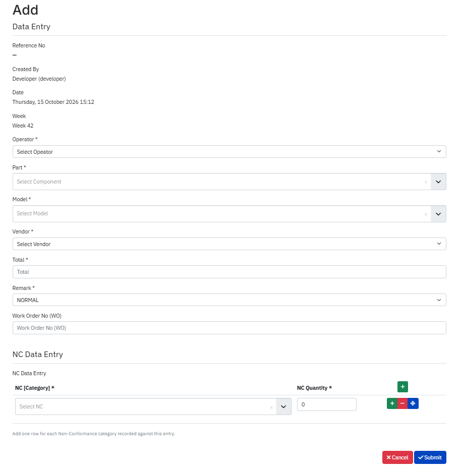
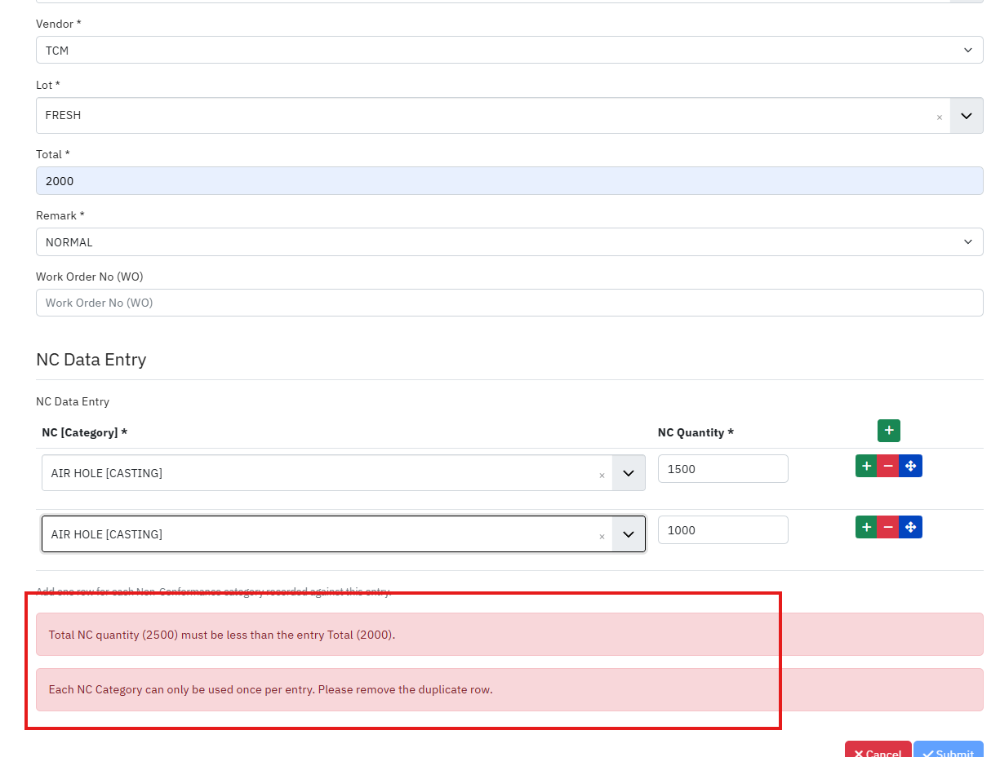
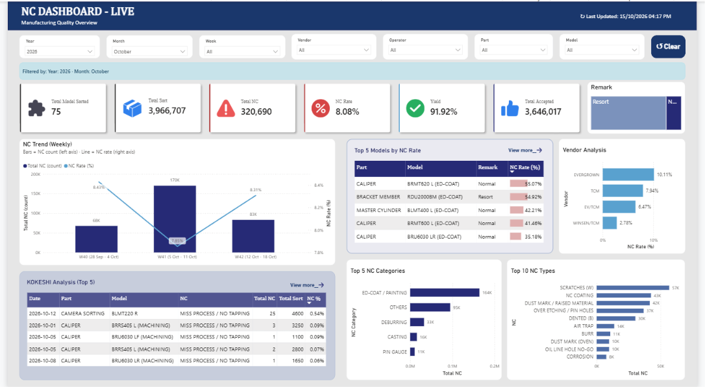

# Manufacturing Quality Analytics

## Project Overview

Developed a web-based production and non-conformance (NC) data collection system integrated with a relational database and Power BI reporting.

## Key Features

- Production and NC data collection using Joomla
- Centralized database storage
- Data validation and duplicate submission controls
- Operational monitoring dashboards
- Power BI KPI and trend analysis
- NC analysis by category, type, model, and vendor
- System documentation and refresh troubleshooting procedures

## Technology Stack

- Joomla
- Relational Database / SQL
- Microsoft Power BI
- Power Query
- DAX

## System Workflow

Data Collection → Data Validation → Database → Joomla Reporting and Power BI → Quality Analysis

 

## My Contribution

- Developed the data collection workflow.
- Implemented system-level data validation controls.
- Built operational dashboards and Power BI reports.
- Designed KPI monitoring and quality analysis views.
- Prepared system documentation and maintenance guidance.

## Project Screenshots

### Data Entry and Validation

| Data Entry Form | Validation Message |
|-----------------|--------------------|
|  |  |
| Production information with multiple NC lines | Rules such as NC quantity ≤ total are enforced on the server |

| Data Entry List | NC Data Entry List |
|-----------------|--------------------|
|  |  |

### Reporting and analytics

#### Joomla Site

*Joomla internal dashboard: KPI cards, NC trend, top models, vendor analysis and NC breakdown.*

-----------------

| NC Report Monthly | NC Report Weekly |
|-----------------|--------------------|
|  |  |
|  |  |

| Model Summary | Daily NC% Summary | Operator Analysis | 
|-----------------|--------------------|-----------------|
|  |  |  | 

-----------------
#### BI Dashboard

*Power BI dashboard built on the sample data: quality overview, NC trend and breakdowns by category and type.*

### Documentation

- [System architecture](docs/architecture.md)
- [Data flow](docs/data-flow.md)
- [Technical documentation](docs/technical-documentation.md)

## Data Privacy

- **All data is fictional.** The database contents in `database/sample_data.sql` and everything shown in
  the screenshots are invented for demonstration. Names, models, vendors, work orders, lot numbers
  and quantities do not come from a real production system.
- **No real accounts or credentials.** The sample users use `example.com` addresses and non-functional
  placeholder passwords. No API tokens, passwords, connection strings or server details are included.
