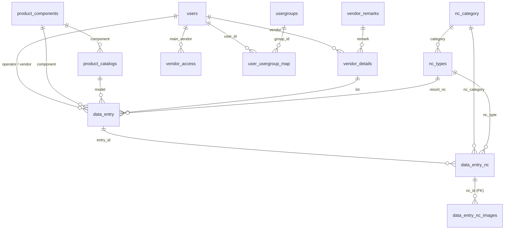

# Production Data & NC Tracking: Database Design

A MariaDB/MySQL schema for a Joomla 5 custom component that records daily production
(inspection) entries and the non-conformances (NC, i.e. defects) found in each entry,
with photo evidence, vendor access control and product master data.

> **All data in this repository is fictional.** Names, models, work orders, users and
> passwords are invented for demonstration. No production records or real accounts are included.

## Repository layout

```
database/
  schema.sql        Table definitions, indexes, keys and foreign keys (no data)
  sample_data.sql   Fictional demo records
README.md
```

## Quick start

Requires MariaDB 10.11+ (or a compatible MySQL version).

```bash
mysql -u root -p -e "CREATE DATABASE production_demo CHARACTER SET utf8mb4 COLLATE utf8mb4_unicode_ci;"
mysql -u root -p production_demo < database/schema.sql
mysql -u root -p production_demo < database/sample_data.sql
```

Tables use the prefix `jos_`. To use a different prefix, replace it before importing:

```bash
sed 's/jos_/myprefix_/g' database/schema.sql > schema_custom.sql
sed 's/jos_/myprefix_/g' database/sample_data.sql > sample_data_custom.sql
```

## Overview

| Area | Tables | Purpose |
|------|--------|---------|
| Transactions | `data_entry`, `data_entry_nc`, `data_entry_nc_images` | One production entry, its NC lines, and photos of each NC |
| NC master data | `nc_category`, `nc_types` | Defect categories and the defect types under each |
| Product master data | `product_components`, `product_catalogs` | Components, their models and expected output rates |
| Vendors | `vendor_remarks`, `vendor_details`, `vendor_access` | Which remark options each vendor can use, and which vendors a vendor manager can see |
| Users and roles | `users`, `usergroups`, `user_usergroup_map` | Joomla core tables (trimmed) with project roles: Operator, Vendor, Vendor Manager, API Sync |

## Entity relationships



### How the tables connect

- A **`data_entry`** row is one production/inspection record: date, ISO week, component, model,
  vendor, operator, total quantity and a reference number (`IR` + `yymmdd` + running number).
- Each entry has zero or more **`data_entry_nc`** rows, one per defect type found. They store the
  category, type, quantity and `nc_percentage` (`nc_quantity / total * 100`).
- Each NC row can have photos in **`data_entry_nc_images`**. This is the only enforced foreign key,
  with `ON DELETE CASCADE`.
- **`nc_types`** belong to an **`nc_category`** through `nc_types.category`.
- **`product_catalogs`** lists the models of each component and their expected output per normal and overtime shift.
- **`vendor_details`** says which remark options a vendor can use. `data_entry.lot` stores the
  `vendor_details.id` chosen for the entry. **`vendor_access`** lets a vendor manager see a list of vendors.
- `data_entry.remark` is `1` for a normal entry and `0` for a re-sort. For re-sorts, `resort_nc`
  holds the `nc_types.id` being re-sorted.

### Design notes

- **Joomla conventions.** Most tables share the standard columns `state`
  (`1` published, `0` unpublished, `-2` trashed), `ordering`, `checked_out`, `checked_out_time`,
  `created_by`, `modified_by` and `custom_field_1..5`.
- **Soft references.** Several links are stored as text or varchar IDs (for example
  `data_entry.component`, `data_entry.model`, `data_entry_nc.nc_type`) because the
  component's forms store them that way. Only the NC images link has a real foreign key, so queries
  need a `CAST(... AS UNSIGNED)` when joining on a text column.
- **Trashed rows.** Filter on `state = 1` for active records. The sample data contains one trashed entry.

## Sample data

`sample_data.sql` loads a small, consistent data set:

- 10 demo users (admin, API sync, 3 operators, 1 vendor manager, 4 vendors) with placeholder passwords that cannot be used to log in.
- 8 NC categories and 34 NC types (including one unpublished and one trashed type).
- 6 components and 14 catalog models.
- Vendor remarks and per-vendor remark assignments.
- 15 production entries across ISO weeks 41 and 42 of 2026, including two re-sort entries and one trashed entry.
- 30 NC lines linked to those entries, and 5 NC photo records.

The photo records contain metadata only. The image files themselves are not included.

## Example queries

Weekly NC rate:

```sql
SELECT e.week,
       SUM(e.total)                          AS inspected,
       SUM(n.nc_total)                       AS nc_qty,
       ROUND(SUM(n.nc_total) / SUM(e.total) * 100, 2) AS nc_percent
FROM jos_data_entry e
LEFT JOIN (
    SELECT entry_id, SUM(nc_quantity) AS nc_total
    FROM jos_data_entry_nc
    GROUP BY entry_id
) n ON n.entry_id = e.id
WHERE e.state = 1
GROUP BY e.week
ORDER BY e.week;
```

Top defect types:

```sql
SELECT c.category, t.nc AS defect, SUM(n.nc_quantity) AS qty
FROM jos_data_entry_nc n
JOIN jos_data_entry e   ON e.id = n.entry_id AND e.state = 1
JOIN jos_nc_types t     ON t.id = CAST(n.nc_type AS UNSIGNED)
JOIN jos_nc_category c  ON c.id = t.category
GROUP BY c.category, t.nc
ORDER BY qty DESC
LIMIT 10;
```

Entries with their component, model, vendor and operator:

```sql
SELECT e.reference_no, e.date, pc.component_name, pm.model_name,
       v.name AS vendor, o.name AS operator, e.total
FROM jos_data_entry e
JOIN jos_product_components pc ON pc.id = CAST(e.component AS UNSIGNED)
JOIN jos_product_catalogs pm   ON pm.id = CAST(e.model AS UNSIGNED)
JOIN jos_users v               ON v.id  = CAST(e.vendor AS UNSIGNED)
JOIN jos_users o               ON o.id  = e.operator
WHERE e.state = 1
ORDER BY e.date;
```

## License

Add a license of your choice (for example MIT) if you want others to reuse the schema.
