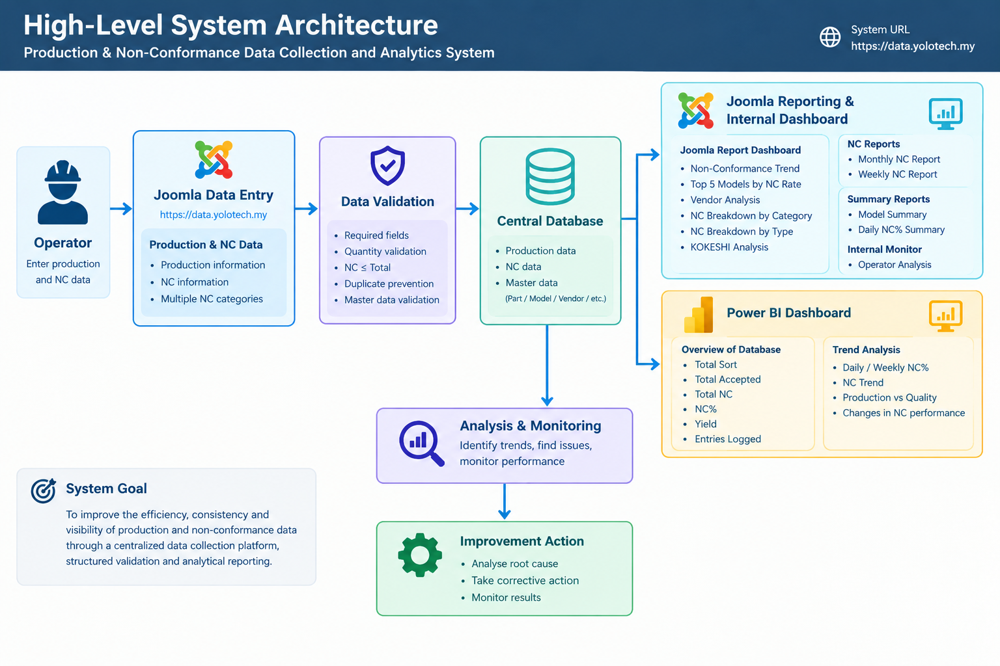
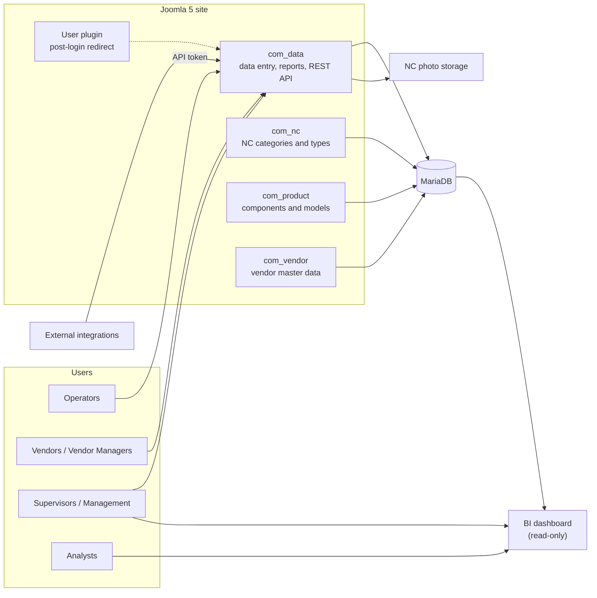

# System Architecture

This document describes the high-level architecture of the production and non-conformance
(NC) data collection and analytics system.

## Goal

Replace a manual, spreadsheet-based process with a centralised web application that:

- collects production and NC data in a structured way,
- ties every record to the authenticated user who entered it,
- reduces invalid and duplicate records, and
- feeds reporting and analytics from one trusted database.

## Layers

| Layer | Technology | Responsibility |
|-------|-----------|----------------|
| Data collection and internal reporting | Joomla 5 custom components (PHP) | Web forms, authentication, validation, internal reports, REST API |
| Storage | MariaDB | Production entries, NC records, NC photos, master data, users and roles |
| File storage | Web server file system | NC photo files (the database stores only the file name and path) |
| Analytics | BI tool (for example Power BI), read-only database connection | KPI dashboards, trends and breakdowns |

## Diagram

## Components

### Joomla components

| Package | Role |
|---------|------|
| `com_data` | Core component: the production and NC entry form, entry lists, internal reports and the REST API |
| `com_nc` | Maintains NC categories and NC types |
| `com_product` | Maintains product components and the model catalog, including expected output per shift |
| `com_vendor` | Maintains vendor remark options, per-vendor remark assignment and vendor visibility |
| `plg_user_comdataredirect` | User plugin that handles redirection for logged-in users |

The master-data components (`com_nc`, `com_product`, `com_vendor`) control the options shown in
the data entry form, so users choose from approved values instead of typing free text.

### Database

One relational database holds everything. The main production entry (`data_entry`) is the parent
record. Each entry has zero or more NC lines (`data_entry_nc`), and each NC line can have photos
(`data_entry_nc_images`). Master-data tables supply categories, types, components, models and vendors.
See [`database/schema.sql`](../database/schema.sql) and the entity diagram in the
[root README](../README.md).

### Analytics

The BI tool connects to the database with a read-only account and reads the entry, NC and master-data
tables. Date, model, vendor, user and NC category and type act as the dimensions of the analysis.
Because the dashboard reads straight from the database, anything saved in Joomla appears in the
dashboard after the next scheduled refresh.

### Integrations

External systems use the Joomla Web Services API with an API token, which is issued to a user in
the dedicated **API Sync** group. See [`application/README.md`](../application/README.md) for setup.

## Security and access

- **Authentication:** every user signs in with a Joomla account. Records store who created them.
- **Server-side identity:** the operator on an entry is derived from the authenticated account on the
  server, so the value cannot be changed by editing the page in the browser.
- **Roles:** Operator, Vendor, Vendor Manager, supervisors/management and API Sync. See
  [technical-documentation.md](technical-documentation.md#roles-and-access).
- **API:** token-based, using an account that has only the access the integration needs.
- **Analytics:** a read-only database account, restricted to the BI tool.
- **Secrets:** tokens, passwords and connection details are never stored in the repository.

## Design principles

1. **One source of truth.** All reports read the same tables.
2. **Controlled input.** Dropdowns come from master data, and the server validates every submission.
3. **Traceability.** Each entry has a reference number, a creator, a timestamp and a trashed/active state.
4. **Separation of concerns.** Collection, storage and analytics are separate layers, so each can
   change without breaking the others.
