### Internal Dashboard

A Joomla dashboard that gives supervisors a quick overview of production quality for a selected month, week or date. It combines headline KPIs with trend, ranking and breakdown views, so users can move from overall performance to specific models, vendors and defect types.

**Key features**
- Period selection by month, week and date, with filters for part, model, vendor, lot, remark, operator, NC category and NC type
- KPI cards for Total Sort, Total Accepted, Total NC, NC%, Yield% and Entries Logged
- NC trend chart showing daily NC volume by category
- Top 5 models by NC rate and vendor analysis tables
- NC breakdown by category and by type

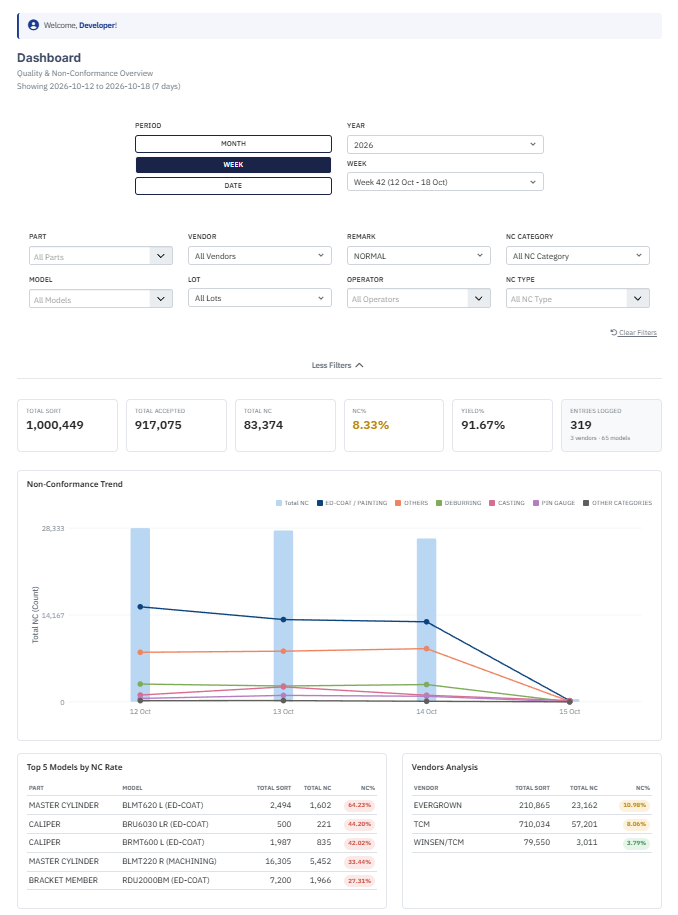
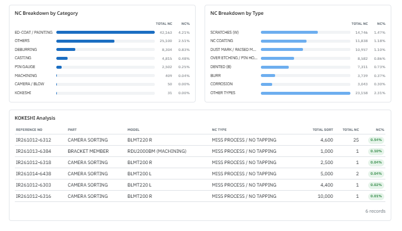

### Weekly & Monthly NC Report

A detailed report of non-conformance trends for a selected week. It lists every NC category and type with daily quantities and percentages, so users can see which defects are growing and on which days they occur.

**Key features**
- Weekly summary cards: Total Sort, Total Accepted, Total NC, NC% and Yield%
- NC quantity and NC% for each day of the week, by category and type
- Weekly NC% per defect type
- Colour-coded categories and highlighted high values for faster scanning
- Year and week selection with additional filters

| NC Report Monthly | NC Report Weekly |
|-----------------|--------------------|
| 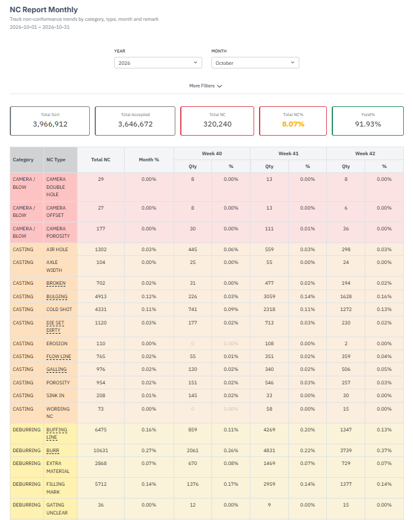 | 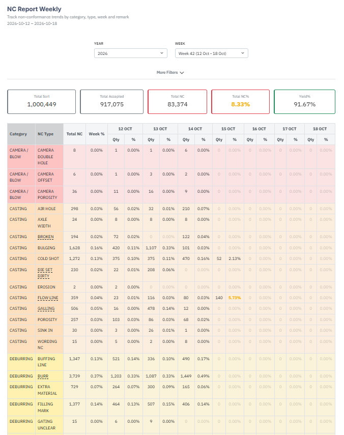 |
| 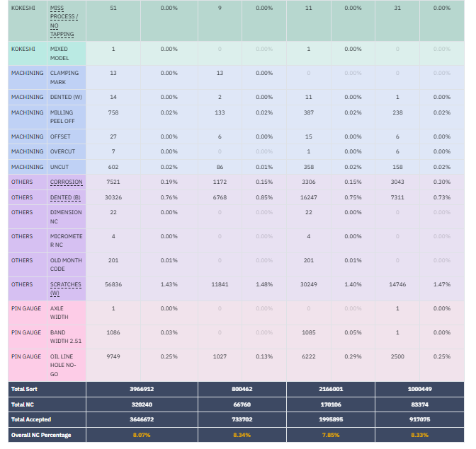 | 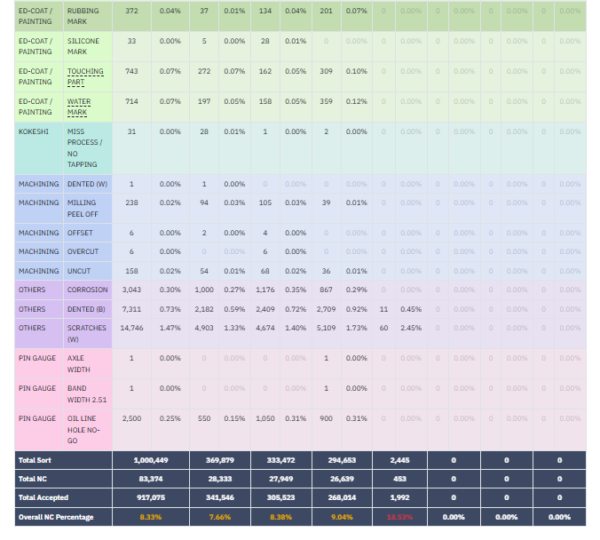 |

### Model Summary

A ranking of models and parts by defect rate over a selected period. It helps quality teams decide where to investigate first.

**Key features**
- Top 5 models by NC% shown as highlight cards, with NC and sort quantities
- Full table of last update, part, model, vendor, remark, Total Sort, Total Accepted, Yield%, Total NC and NC%
- Sorted by NC% so high-risk models appear at the top
- Analysis by month, week or date

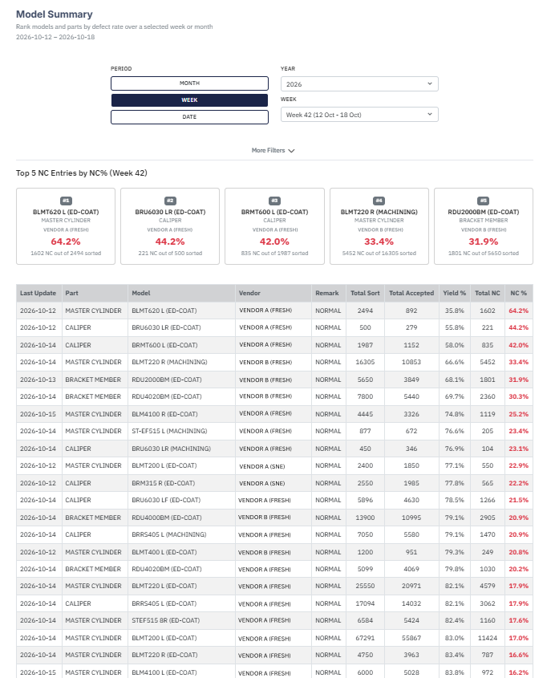

### Daily NC% Summary

A heat-map style table that shows how NC% changes day by day for each part, model and vendor within a week. It highlights days and models where quality dropped.

**Key features**
- NC% for every model and vendor combination, across each day of the selected week
- Colour thresholds (green, amber, red) to show low, medium and high NC rates at a glance
- Filters for year, week, part, model, vendor and remark
- Days without data are left blank, so incomplete days are not mistaken for good days

 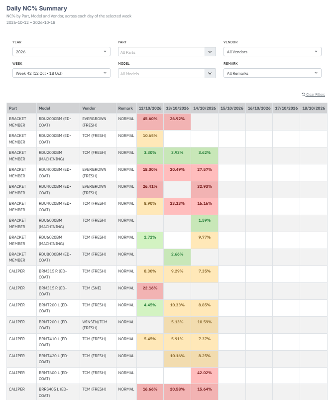 

### Data Entries

The main working list for production and NC records. Users search, filter, review and manage entries from one screen, and start a new entry from it.

**Key features**
- Reference number, part, model, vendor, remark, operator, Total Sort and Total NC for each entry
- Filters for part, model, vendor, remark, re-sort type, year, month, week and date range, plus search
- View, edit and delete actions for each entry
- Export report and add-entry buttons
- Active and trashed records are separated, so deleted entries can be recovered

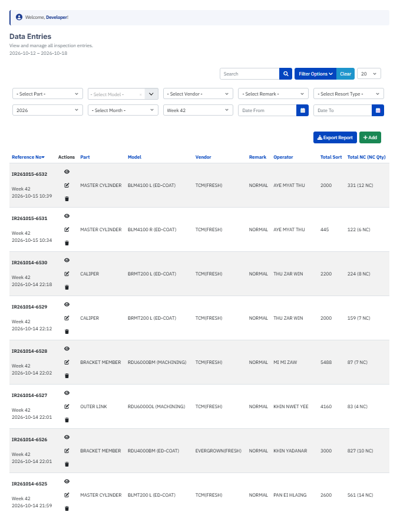

### NC Entries

A drill-down table for a specific process-related NC type. It lists the individual entries involved, so supervisors can look at the records behind the numbers.

**Key features**
- Reference number, part, model, NC type, Total Sort, Total NC and NC% for each record
- NC% badges for quick comparison
- Updates with the period and filters chosen on the dashboard

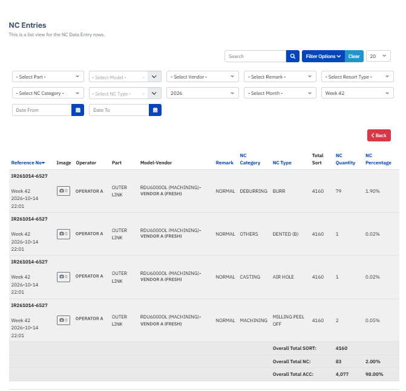

### Operator Performance Dashboard

An interactive dashboard designed to monitor operator-level production performance and non-conformance (NC) trends. It includes time-based filters, a production-versus-quality bubble chart, and separate quality and production rankings.

**Key features**
- Time-based analysis by month, week, and date
- Production volume and NC rate comparison
- Quality and production ranking tables
- Visual identification of performance patterns and potential quality issues

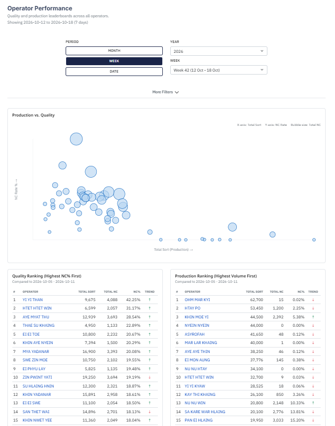 

### Power BI Quality Dashboard

An interactive Power BI report built on the same database for management review. It focuses on KPIs and trends across several weeks, with slicers for fast analysis.

**Key features**
- Slicers for year, month, week, vendor, operator, part and model, and a clear-filters button
- KPI cards for total sorted, total accepted, total NC, NC rate and yield, with a normal and re-sort split
- Weekly NC trend with NC count and NC rate on a combined chart
- Top 5 models by NC rate, vendor analysis, and top NC categories and types
- Refresh information, so users know how current the data is

